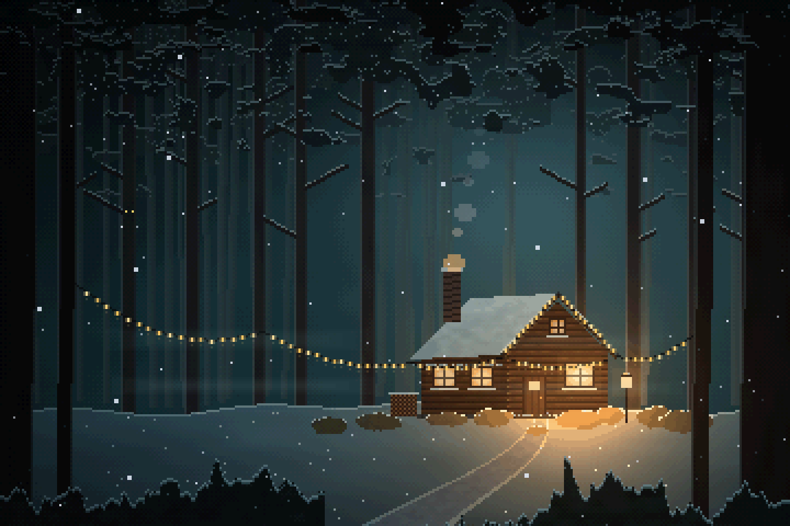
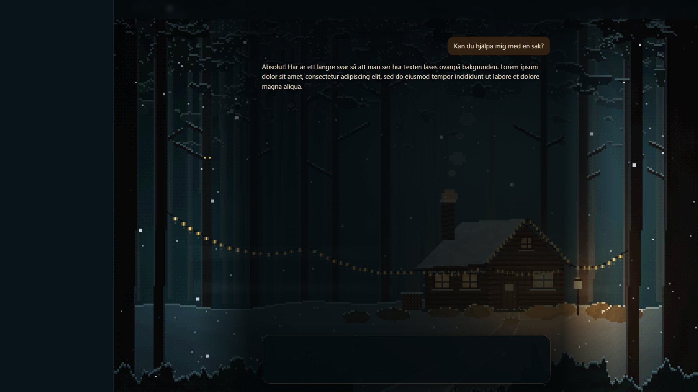
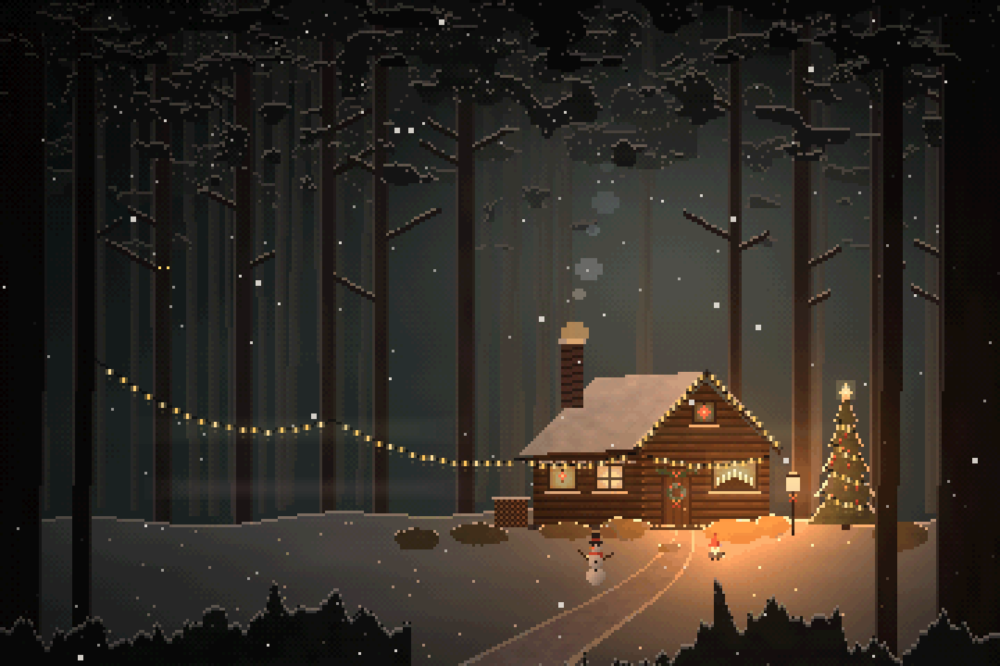
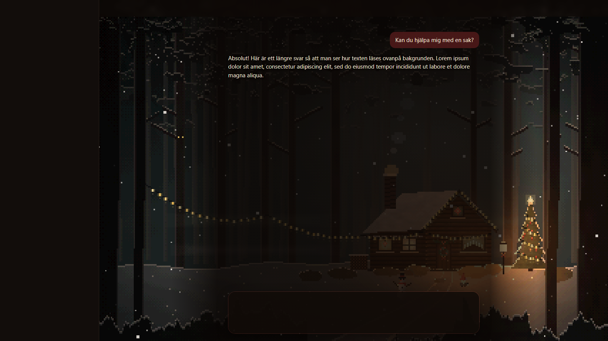

# Cozy pixel-art themes for T3 Code

Two animated themes for [T3 Code](https://github.com/pingdotgg/t3code). Each one shows a small log cabin in a snowy forest at night behind your chat. The scene is drawn as pixel art.

## Pixelstugan

A cabin in the woods with string lights, glowing windows, chimney smoke, drifting fog and falling snow.

## Julstugan

The same cabin dressed for Christmas. It has a lit spruce with a star, an advent candlestick in the window, red paper stars, a wreath on the door, a small tomte with a lantern and a snowman. The colors are warmer, and buttons and your own messages are Christmas red.

## How to install

1. Make sure T3 Code is up to date. You need a version that supports custom CSS in themes. Older versions only import the colors, and the scene will not show.
2. Download the theme file you want from the `themes` folder: `pixelstugan.json` or `julstugan.json`.
3. In T3 Code, open the settings and go to Appearance.
4. Import the theme file and select the theme.

If you imported an older copy of the same theme before, remove it first and then import again.

## Good to know

- The scene only shows in dark mode. In light mode you get warm, light colors without the picture.
- If animations are turned off on your computer, the scene stands still. On Windows this is the "Animation effects" setting.
- The background picture is built into the theme file, so the single JSON file is all you need.

## Making your own version

The `source` folder has the script that draws each theme. You need [Node.js](https://nodejs.org). Run `node build.js` inside `source/pixelstugan` or `source/julstugan`. The script writes the theme file, the picture and a preview page next to itself.

The theme file to share is the one that ends in `-dela.json`. It has the picture built in.

## Author

Made by Hanna Adenholm.
